# CVE2Rule

A multi-agent threat hunting and detection-engineering lab. Enter a CVE and the system researches it, extracts IOCs and MITRE ATT&CK techniques, generates hunting hypotheses and a Sigma rule with tests, validates it in CI, deploys it to Microsoft Sentinel, and hands alerts to a SOAR agent that proposes containment for human approval.

The project doubles as a learning path for AI engineering: SDLC, CI/CD, testing, evaluation, and agent orchestration.

> Run everything in an isolated lab with synthetic data. Never run Atomic Red Team tests or block IPs on production systems.

---

## 1. Goals

- Build a working end-to-end agentic detection pipeline.
- Learn AI engineering practices: agent design, prompt/output evaluation, testing, CI/CD, observability.
- Learn detection engineering: Sigma, KQL, Sentinel analytics rules.
- Learn adversary emulation with Atomic Red Team.

---

## 2. End-to-end workflow

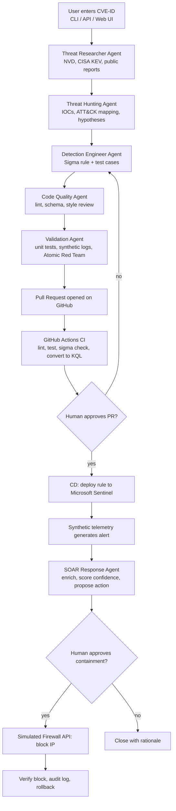

This diagram shows the finished system. Section 8 builds it up one slice at a time.

### Example run: `CVE-2021-44228` (Log4Shell)

1. Researcher pulls NVD record, checks CISA KEV, gathers public reports.
2. Hunting agent extracts IOCs (`${jndi:ldap://...}` patterns, callback domains/IPs) and maps to ATT&CK (e.g. T1190, T1059, T1105).
3. Hypothesis: a Java process spawns a shell or makes an unexpected outbound LDAP/RMI connection.
4. Detection agent writes a Sigma rule (child process of `java` running `sh`/`bash`/`curl`/`wget`) plus positive and negative test logs.
5. PR is opened; CI lints, runs tests, validates the Sigma schema, and converts to KQL.
6. You review and merge; CD deploys to Sentinel as an analytics rule.
7. Synthetic Java process/network events are ingested; the alert fires.
8. SOAR agent proposes blocking the synthetic external IP; you approve; the simulated firewall blocks it; the agent verifies and records an audit entry.

### Example run 2: `CVE-2026-88771` (Citrix NetScaler ADC/Gateway)

Chosen from the advisory set `CVE-2026-88771` to `CVE-2026-88778` (Citrix bulletin CTX697096). Values below come from NVD as of 2026-10-17; re-check them when the researcher agent runs.

| Field | Value |
|---|---|
| Weakness | Improper input validation (CWE-20) |
| Impact | Unauthenticated remote command execution |
| CVSS v3.1 | 9.8 Critical (`AV:N/AC:L/PR:N/UI:N`) |
| CISA KEV | Yes, added 2026-09-27, due 2026-09-30 |
| SSVC | Exploitation: active, automatable: yes, technical impact: total |
| Affected | NetScaler ADC and Gateway before 14.1-73.37 and before 13.1-64.23 (plus FIPS/NDcPP builds) |

**Why this one**
- It is the only one in the set that is both actively exploited (KEV, SSVC "active") and unauthenticated command execution, so it has the clearest hunting hypothesis.
- `CVE-2026-88772` is also in KEV, but it is a memory-corruption bug (CWE-119) with high attack complexity. It is hard to detect from behaviour and a poor first rule.
- `CVE-2026-88773` (request smuggling) and `88774` to `88778` (overflow, policy bypass, predictable values) are not in KEV or have no exploitation evidence, and mostly cause DoS or information exposure.

**Pipeline walkthrough**
1. Researcher pulls the NVD record, confirms KEV status, and collects the vendor advisory and public reports.
2. Hunting agent extracts IOCs only from sourced reports (the NVD record itself lists none), and proposes ATT&CK mappings such as T1190 (exploit public-facing application) and T1059 (command execution) for review.
3. Hypotheses:
   - A NetScaler appliance receives an unusual request, then spawns a shell or an unexpected child process.
   - The appliance makes an unexpected outbound connection to an external IP after an inbound request.
4. Detection agent writes a Sigma rule with positive and negative synthetic logs.
5. CI, human approval, and Sentinel deployment follow the same path as example 1.
6. SOAR agent proposes blocking the synthetic source IP; you approve; the simulated firewall blocks it; the agent verifies and audits.

**Lab caveat:** a NetScaler appliance does not run Atomic Red Team or Elastic/Sentinel agents. Replay synthetic syslog/CEF events into a custom Sentinel table instead, and use a generic Linux web-server process-creation test for the Atomic exercise.

Compare both examples: Log4Shell has rich public IOCs and endpoint telemetry, while the Citrix case tests how the agent behaves when IOCs are sparse and the data source is an appliance.

---

## 3. Agents

| Agent | Kind | Built in | Responsibility | Inputs | Outputs |
|---|---|---|---|---|---|
| Threat Researcher | LLM | Slice 0b | Gather CVE facts from NVD (KEV and ATT&CK added in Slice 1) | CVE ID | Structured CVE intel (CVSS, KEV status, affected products, references) |
| Threat Hunting | LLM | Slice 2 | Fetch threat reports, extract IOCs, map to MITRE ATT&CK, form hypotheses | CVE intel, reference URLs | IOC list with sources and confidence, ATT&CK techniques, hypotheses |
| Detection Engineer | LLM | Slice 3 | Write Sigma rules and test cases | Hypotheses, IOCs | `rules/*.yml`, `tests/rules/*.json` |
| Code Quality | Deterministic | Slice 3 | Check style, schema, secrets, rule metadata, unique rule IDs | Generated files | Pass/fail report with reasons |
| Validation / Test | Deterministic | Slice 3 (Atomic in Slice 6) | Run rule against positive/negative logs; optional Atomic tests | Rule, test data | Test report, precision/recall on synthetic data |
| Evaluation | Deterministic (+ optional LLM judge) | Slice 1 | Score agent outputs (grounding, schema, hallucination) | Agent outputs, golden set | Eval metrics |
| CI/CD | Deterministic | Slices 0, 4, 5 | Open PR, run pipeline, deploy on approval | Validated rule | PR, deployment record |
| SOAR Response | LLM | Slice 7 | Enrich alert, propose containment, execute after approval | Sentinel alert | Action proposal, execution result, audit entry |

"Deterministic" nodes are plain Python graph nodes or tools, not LLM calls. Use an LLM only where reasoning over unstructured text is needed.

Human-in-the-loop gates: PR approval (rule deployment) and containment approval (SOAR).

---

## 4. Target architecture

This is the end state. Section 8 builds it up slice by slice, each with its own smaller diagram.

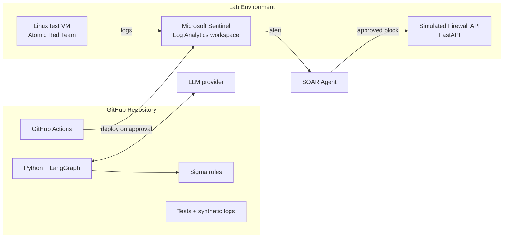

### Design principles

- Agents are LangGraph nodes with typed state (Pydantic models) and structured outputs.
- Every LLM output is schema-validated; no free text flows between agents.
- Deterministic tools (NVD client, Sigma converter, test runner) are separate from LLM reasoning.
- Human approval is a graph interrupt, not a prompt convention.
- All SOAR actions are idempotent, logged, and reversible.

---

## 5. Tech stack

| Layer | Choice | Why |
|---|---|---|
| Language | Python 3.11+ | Ecosystem for security and AI |
| Agent orchestration | LangGraph | Stateful graphs, human-in-the-loop interrupts |
| LLM | OpenAI / Azure OpenAI / Anthropic (configurable) | Swap via env var |
| Config | pydantic-settings | Pinned model version, per-call and per-run token caps |
| Data models | Pydantic v2 | Validation of agent I/O |
| Intel sources | NVD API 2.0, CISA KEV JSON, MITRE ATT&CK (STIX), public reports | Free and authoritative |
| Detection format | Sigma | Vendor-neutral |
| Rule conversion | pySigma + `pySigma-backend-kusto`, `sigma-cli` | Sigma to KQL |
| Rule testing | Sigma converted to SQLite (`pySigma-backend-sqlite`) or Zircolite, run against JSON logs | Local rule tests without a SIEM |
| SIEM | Microsoft Sentinel (Log Analytics) | Target platform |
| Emulation | Atomic Red Team + Invoke-AtomicRedTeam | Realistic test telemetry |
| SOAR target | FastAPI simulated firewall (Docker) | Safe containment |
| Testing | pytest, pytest-cov, hypothesis | Unit and property tests |
| Quality | ruff, mypy, bandit, pre-commit | Lint, types, security |
| Eval | pytest-based golden sets, optional promptfoo / DeepEval | LLM output quality |
| CI/CD | GitHub Actions | Pipeline |
| IaC | Bicep or Terraform | Sentinel workspace, rule deployment |
| Containers | Docker, docker-compose | Reproducible lab |
| Observability | structlog, LangSmith (optional) | Tracing agent runs |
| Secrets | GitHub Secrets, Azure Key Vault, OIDC to Azure | No static credentials |

---

## 6. Repository layout

```
github_actions/
├── README.md
├── pyproject.toml
├── .pre-commit-config.yaml
├── .env.example
├── docker-compose.yml
├── src/cve2rule/
│   ├── cli.py                 # entry point: cve2rule research CVE-2021-44228
│   ├── config.py              # model name, token caps, provider settings
│   ├── api.py                 # optional FastAPI endpoint
│   ├── graph.py               # LangGraph workflow
│   ├── state.py               # Pydantic state models
│   ├── agents/
│   │   ├── researcher.py
│   │   ├── hunter.py
│   │   ├── detection_engineer.py
│   │   ├── code_quality.py
│   │   ├── validator.py
│   │   ├── evaluator.py
│   │   └── soar.py
│   ├── tools/
│   │   ├── nvd.py
│   │   ├── cisa_kev.py
│   │   ├── attack.py
│   │   ├── sigma_convert.py
│   │   ├── github_pr.py
│   │   └── sentinel.py
│   └── prompts/
├── rules/                     # Sigma rules (hand-written, later generated)
├── pipelines/                 # custom pySigma pipelines: Sigma fields -> table columns
├── tests/
│   ├── unit/
│   ├── rules/                 # rule tests with synthetic logs
│   │   └── holdout/           # human-written logs, never shown to generators
│   ├── evals/                 # LLM golden-set evals
│   └── data/
├── lab/
│   ├── firewall_api/          # simulated firewall
│   ├── atomic/                # Atomic Red Team runbooks
│   └── infra/                 # Bicep/Terraform for Sentinel, custom table schemas
├── docs/
└── .github/workflows/
    ├── ci.yml                 # lint, test, rule validation
    ├── eval.yml               # LLM evals (scheduled / manual)
    └── deploy.yml             # deploy rule to Sentinel after approval
```

---

## 7. CI/CD pipeline

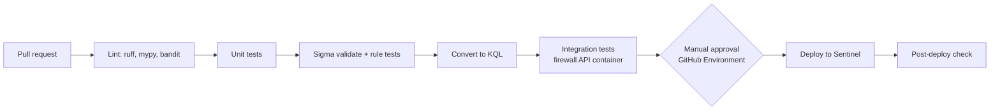

This is the final pipeline. Each slice in section 8 adds the stages it needs.

- `ci.yml` runs on every PR.
- `deploy.yml` runs on merge to `main` and uses a protected GitHub Environment requiring reviewer approval.
- Azure auth uses OIDC federated credentials, not stored secrets.
- LLM calls in CI are mocked; real-model evals run in `eval.yml` on schedule or manual dispatch.

---

## 8. Build plan: thin slice first

Build a thin version of the whole pipeline first (a "walking skeleton"), then deepen one stage per slice. Every slice ends with a working, committed pipeline, so you always have something that runs end to end.

Rules for every slice:
- Work on a branch, open a PR, and merge only when CI is green.
- Each step produces working code and teaches one concept (*Learn:*).
- A slice is finished only when its **Done when** check passes.
- Anything not built yet stays manual (you do it by hand) or is skipped. Don't build stubs for future slices.

```mermaid
flowchart LR
    S0A[Slice 0a<br/>Repo, CI, NVD client] --> S0B[Slice 0b<br/>Walking skeleton]
    S0B --> S1[Slice 1<br/>Grounding + evals]
    S1 --> S2[Slice 2<br/>Hunting agent]
    S2 --> S3[Slice 3<br/>Detection agent + graph]
    S3 --> S4[Slice 4<br/>PR automation]
    S4 --> S5[Slice 5<br/>Sentinel CD]
    S5 --> S6[Slice 6<br/>Atomic Red Team]
    S6 --> S7[Slice 7<br/>SOAR]
    S7 --> S8[Slice 8<br/>Hardening]
```

| Slice | Adds | Still manual or not yet built |
|---|---|---|
| 0a | Tooling, branch protection, CI (lint, types, tests), NVD client, CLI | Everything with an LLM |
| 0b | Config with token caps, Researcher agent, table schema, custom pySigma pipeline, hand-written rule and held-out logs, rule tests, KQL output | Hunting, rule writing, PRs, Sentinel, SOAR |
| 1 | CISA KEV, ATT&CK lookup, eval harness, `eval.yml` with a cost cap | Hunting, rule writing, PRs, Sentinel, SOAR |
| 2 | Report fetcher, Hunting agent with sourced IOCs | Rule writing, PRs, Sentinel, SOAR |
| 3 | Detection Engineer agent, quality checks, validator, full LangGraph | PRs, Sentinel, SOAR |
| 4 | Agent opens PR | Sentinel, SOAR |
| 5 | Sentinel provisioning, `deploy.yml` with undeploy, synthetic ingestion (endpoint and appliance) | Real telemetry, SOAR |
| 6 | Atomic Red Team VM and telemetry | SOAR |
| 7 | Simulated firewall, SOAR agent, approval, rollback | Nothing |
| 8 | Guardrails, observability, security review, demo | Nothing |

New components in each diagram below are drawn with a thick green border.

---

### Slice 0a: Repo, CI and first tool (no LLM)

**Goal:** green CI and a CLI that prints a parsed NVD record, before any LLM code.

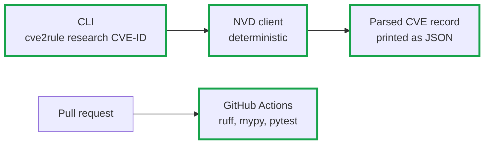

**Steps**
1. **Repo and tooling**: `pyproject.toml`, virtualenv, ruff, mypy, pytest, pre-commit, `.env.example`. *Learn: project structure, dependency management.*
2. **Branch protection**: protect `main`, require PRs and passing status checks. *Learn: SDLC, code review.*
3. **First CI**: `ci.yml` runs ruff, mypy and one trivial test on every PR, with pip caching. *Learn: GitHub Actions triggers, jobs, caching.*
4. **NVD client** (`tools/nvd.py`): fetch one CVE, parse it into a Pydantic model, handle rate limits and missing fields. Unit tests use recorded HTTP responses, never the live API. *Learn: API clients, test doubles.*
5. **CLI** (`cli.py`): `cve2rule research CVE-2021-44228` prints the parsed record as JSON. *Learn: entry points.*

**Done when:** `cve2rule research CVE-2021-44228` prints the parsed NVD record, and a PR gets green CI with ruff, mypy and pytest.

---

### Slice 0b: Walking skeleton

**Goal:** `CVE-ID → Researcher → you hand-write a Sigma rule → CI → KQL file`. No Sentinel, no SOAR, no generated rules.

The rule, the test logs and the KQL all have to agree on field names. This slice fixes the target table schema first and maps Sigma fields to it with one custom pipeline. The rule tests and the KQL conversion both use that pipeline, so CI tests the mapping and not only the rule logic.

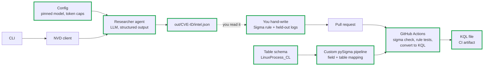

**Steps**
1. **Config** (`config.py`, pydantic-settings): LLM provider, a pinned model version (not a floating alias), a per-call token limit and a per-run token cap. A run that hits the cap stops with a clear error. *Learn: cost and reproducibility controls.*
2. **Researcher agent** (`agents/researcher.py`): one LangGraph node that calls the NVD tool and returns a `CveIntel` Pydantic model through structured output. It reports only CVE facts from NVD; threat reports come in Slice 2. *Learn: prompts, structured outputs, tool calling.*
3. **CLI writes intel**: `cve2rule research CVE-2021-44228` now writes `out/CVE-2021-44228/intel.json` and logs token usage for the run. Unit tests use a fake LLM so CI never calls a real model. *Learn: dependency injection for testability.*
4. **Table schema** (`lab/infra/schemas/LinuxProcess_CL.json`): define the columns of the custom process-creation table, for example `TimeGenerated`, `Computer`, `User`, `ProcessName`, `CommandLine`, `ParentProcessName`, `ParentCommandLine`. This schema is the contract for test logs, the pipeline and the Sentinel table in Slice 5. *Learn: data modelling for detections.*
5. **Custom pySigma pipeline** (`pipelines/linux_process.yml`): map Sigma's `process_creation` fields (`Image`, `CommandLine`, `ParentImage`, ...) to the table columns and set the KQL target table. The built-in Kusto pipelines target Windows/Defender tables, so a Linux rule on a custom table needs its own mapping. *Learn: pySigma processing pipelines.*
6. **Hand-write the Log4Shell rule** from `intel.json`: `rules/log4shell_java_child_shell.yml` (a `java` parent spawning `sh`, `bash`, `curl` or `wget`), with a unique `id`, `status: experimental`, ATT&CK tags, `falsepositives` and `level`. Validate it with `sigma check`. *Learn: Sigma syntax, logsources, modifiers.*
7. **Held-out test logs** (`tests/rules/holdout/`): positive events (exploit-like child processes) and negative events (normal Tomcat/Jenkins/Elasticsearch child processes), written by you and using exactly the table schema columns. No generator ever sees this set (see Slice 3). *Learn: detection unit testing, false-positive thinking.*
8. **Rule tests**: a pytest that converts the rule to SQLite with the custom field mapping (or runs Zircolite with the same mapping), loads the JSON logs, and asserts that every positive event matches and no negative event does. Load the logs into a table that has every column the query names (missing ones as `NULL`), because SQLite fails to prepare a query that names an unknown column. Pin `pySigma`, `sigma-cli` and the backends to versions that work together; `sigma-cli` 3.1 needs pySigma 1.x while the newest SQLite backend needs pySigma 2.x. *Learn: testing detections without a SIEM, dependency pinning.*
9. **Extend CI**: add `sigma check`, the rule tests, and `sigma convert -t kusto -p pipelines/linux_process.yml`. Upload the `.kql` file as a build artifact and print it to the job summary. *Learn: pipeline stages, artifacts.*

**Done when:** `cve2rule research CVE-2021-44228` writes a valid `intel.json` within the token cap, and a PR with the hand-written rule turns CI green and produces a `.kql` file that queries `LinuxProcess_CL` using its real column names.

---

### Slice 1: Grounding and evals

**Goal:** make the Researcher's output trustworthy and measurable before adding more agents.

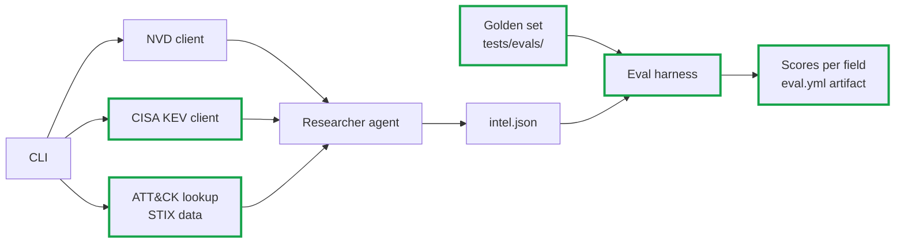

**Steps**
1. **CISA KEV client** (`tools/cisa_kev.py`): download and cache the KEV JSON, look up a CVE, validate it with Pydantic. *Learn: data validation, caching.*
2. **ATT&CK lookup** (`tools/attack.py`): load the Enterprise ATT&CK STIX bundle, look up techniques by ID and name, and reject unknown IDs. *Learn: knowledge-base grounding.*
3. **Extend `CveIntel`** with KEV fields (date added, due date, ransomware use). The agent reports what the tools return and never guesses these values.
4. **Golden set**: 5 to 10 CVEs (including Log4Shell and the Citrix example) with expected CVSS, KEV status, CWE and affected products, checked by hand against NVD and CISA.
5. **Eval harness** (`tests/evals/`, pytest marker `eval`): run the Researcher on the golden set and score schema validity and per-field accuracy. The set is small, so treat accuracy as a trend between runs, not a pass/fail threshold. Schema validity is the only hard failure. *Learn: evaluating LLM output.*
6. **`eval.yml`**: runs on `workflow_dispatch` and on a weekly schedule with the pinned model, under the per-run token cap from Slice 0b. It uploads scores, model name and token usage as an artifact so changes in quality or cost show up. `ci.yml` keeps using the fake LLM. *Learn: separating deterministic CI from nondeterministic evals.*

**Done when:** the eval run reports per-field accuracy and token usage for every golden CVE, stays within its cap, and `ci.yml` still runs fully offline.

---

### Slice 2: Hunting agent

**Goal:** IOCs, ATT&CK techniques and hypotheses, each traceable to a source.

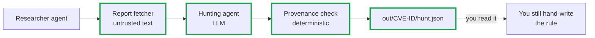

**Steps**
1. **Report fetcher**: fetch reference URLs from the NVD record, strip HTML, enforce size limits and an allow-list of domains, and mark the content as untrusted. *Learn: prompt-injection surfaces.*
2. **Hunting agent** (`agents/hunter.py`): output IOCs where each has `value`, `type`, `source_url`, `quote` and `confidence`; ATT&CK techniques with a rationale; and testable hypotheses. *Learn: grounding, hallucination control.*
3. **Provenance check**: deterministic code that confirms each `quote` exists in the fetched source and each IOC value appears in its quote. Drop or flag anything that fails. *Learn: verifying LLM output in code.*
4. **ATT&CK validation**: every technique ID must exist in the STIX data from Slice 1.
5. **Two-node graph**: Researcher → Hunter in LangGraph with typed state. *Learn: LangGraph state and edges.*
6. **Hunting evals**: add expected IOCs and techniques to the golden set, and track precision, recall and the unsupported-IOC rate.

**Done when:** `cve2rule hunt CVE-2021-44228` writes `hunt.json`, every IOC passes the provenance check, and the sparse Citrix case returns few IOCs instead of made-up ones.

---

### Slice 3: Detection Engineer agent and full graph

**Goal:** the system writes the rule and its tests. Your hand-written Slice 0b rule and held-out logs become the benchmark.

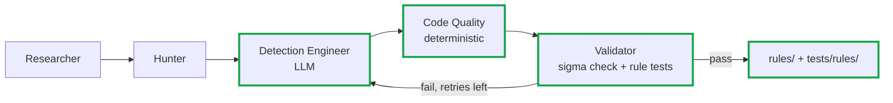

**Steps**
1. **Detection Engineer agent** (`agents/detection_engineer.py`): generate a Sigma rule and its positive and negative test logs from the hypotheses and IOCs. *Learn: generation with structured output.*
2. **Code Quality checks** (`agents/code_quality.py`, deterministic): required fields (`id`, `title`, `status`, `level`, `logsource`, `falsepositives`, `attack.t*` tags), a rule `id` that is unique across `rules/`, new rules starting as `status: experimental`, no wildcard-only selectors, no single-field process-lineage rule without filters, no secrets.
3. **Validator** (`agents/validator.py`): reuses the Slice 0b rule-test code and custom pipeline and returns structured errors.
4. **Retry loop**: a conditional edge sends validator errors back to the Detection Engineer, with a maximum number of retries before stopping with a clear failure. *Learn: conditional edges, bounded loops.*
5. **Wire the full graph** in `graph.py` and add `cve2rule run CVE-ID`. *Learn: state machines.*
6. **Avoid circular testing**: the same LLM writes the rule and its test logs, so it can pass its own tests. Its own tests must still pass, but they don't count as evidence. Score every generated rule against the human-written logs in `tests/rules/holdout/`. Keep that folder out of the agent's prompts, tools and file access. *Learn: held-out evaluation.*
7. **Detection evals**: run the generated rule against the held-out positive and negative logs, record detection and false-positive rates, and compare them with your Slice 0b rule.

**Done when:** `cve2rule run CVE-2021-44228` writes a rule and tests locally, they pass the same CI checks as your Slice 0b rule, and the generated rule matches all held-out positives with no held-out negatives.

---

### Slice 4: PR automation

**Goal:** the agent opens the PR, and you stay the reviewer.

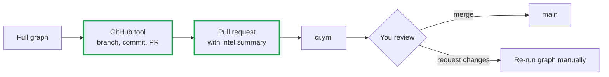

**Steps**
1. **Least-privilege identity**: a fine-grained token or GitHub App limited to this repo, with only contents and pull-request permissions, and unable to push to `main`. *Learn: least privilege.*
2. **GitHub tool** (`tools/github_pr.py`): create a `rule/CVE-ID` branch, commit the rule and tests, and open a PR. *Learn: GitHub API.*
3. **PR body**: CVE summary, KEV status, IOCs with sources, ATT&CK techniques, hypotheses and local test results, so you can review without rerunning anything.
4. **CI job summary**: show the generated KQL and the rule-test results in the PR checks.

**Done when:** `cve2rule run CVE-ID` ends by printing a PR URL, CI is green on that PR, and you merge it yourself.

---

### Slice 5: Sentinel deployment (CD)

**Goal:** merged rules deploy to Sentinel and fire on synthetic data. This comes before Atomic Red Team so that the lab VM in Slice 6 has a workspace to send logs to.

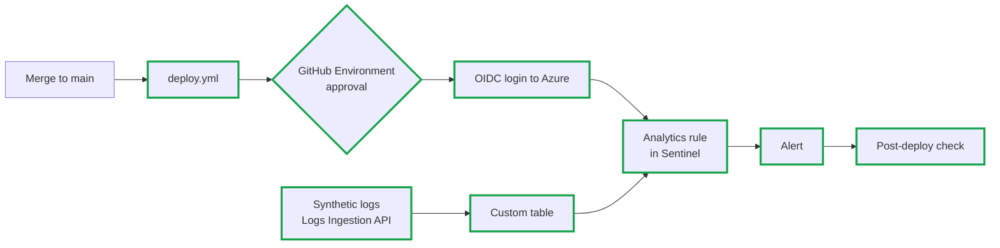

**Steps**
1. **Provision** a Log Analytics workspace and Sentinel with Bicep or Terraform in `lab/infra/`. Add a budget alert and a teardown script on day one. *Learn: IaC, cost control.*
2. **OIDC**: a federated credential for the repo and a protected `sentinel-lab` environment with you as required reviewer. No stored Azure secrets. *Learn: secure deployment.*
3. **Rule packaging**: wrap the KQL as a scheduled analytics rule (ARM template or REST payload) with severity, ATT&CK tactics and query frequency taken from the Sigma metadata. Derive the analytics rule's ID from the Sigma `id`, so redeploying updates the rule in place instead of creating a duplicate.
4. **`deploy.yml`**: on merge to `main`, convert, package and deploy after approval. *Learn: CD, environments.*
5. **Rule lifecycle**: `deploy.yml` compares `rules/` with what is deployed, then creates, updates or deletes. A rule removed from `rules/` is removed from Sentinel. `experimental` rules deploy disabled; `test` and `stable` rules deploy enabled. Promote a rule by changing its `status` in a PR. *Learn: detection-as-code lifecycle, rollback.*
6. **Synthetic ingestion (endpoint)**: a DCR and the `LinuxProcess_CL` table created from the Slice 0b schema, plus a script that sends the held-out positive and negative logs through the Logs Ingestion API. The logs already match the table, so this also tests the field mapping against the real table.
7. **Synthetic ingestion (appliance)**: for the Citrix example, define a second schema and table (for example `NetScaler_CL` with parsed syslog/CEF fields), a matching pipeline in `pipelines/`, and replay synthetic NetScaler events. *Learn: appliance telemetry when no endpoint agent is possible.*
8. **Post-deploy check**: query `SecurityAlert` to confirm the rule fired on the positive events and not on the negative ones. Fail the workflow otherwise.

**Done when:** a merged rule appears in Sentinel, replayed positive logs produce an alert while negatives don't, deleting a rule from `rules/` removes it from Sentinel, and the Citrix replay reaches its own table.

---

### Slice 6: Atomic Red Team telemetry

**Goal:** check rules against real telemetry, not only synthetic JSON.

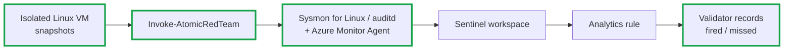

**Steps**
1. **Lab VM** on an isolated network with no production access and no real credentials. Take a clean snapshot. *Learn: safe lab design.*
2. **Telemetry**: install Sysmon for Linux or auditd plus the Azure Monitor Agent, and confirm events arrive in the workspace.
3. **Parse real telemetry into the same shape**: Sysmon for Linux events usually land in the `Syslog` table with the event XML inside `SyslogMessage`, so they don't match `LinuxProcess_CL`. Use the ASIM Sysmon-for-Linux parser if it's available in your workspace, or write a KQL function that outputs the same columns as `LinuxProcess_CL`. Point the rule at a union of the table and the function so one rule covers synthetic and real data. *Learn: normalisation, parsers.*
4. **Install Invoke-AtomicRedTeam** (needs PowerShell 7 on Linux). Run `Invoke-AtomicTest T1059.004 -ShowDetails`, then `-CheckPrereqs`, then the test itself. *Learn: ATT&CK-mapped emulation.*
5. **Map atomics to rules**: each rule declares its expected atomic test in metadata, and the validator records whether the rule fired.
6. **Log4Shell gap**: there is no official atomic, so write a custom atomic that reproduces the behaviour (a Java process spawning a shell), or replay synthetic logs.
7. **Cleanup**: run `-Cleanup` and revert the snapshot after every session.

**Done when:** at least one rule has a recorded atomic run with a fired or missed result, and the VM is back at its clean snapshot.

---

### Slice 7: SOAR agent

**Goal:** turn an alert into an approved, verified and reversible containment action.

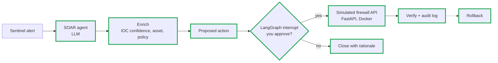

**Steps**
1. **Simulated firewall** (`lab/firewall_api/`): `POST /block`, `GET /status`, `DELETE /block/{ip}`, an audit log, and refusal of anything outside the documentation IP ranges. *Learn: designing a safe action target.*
2. **Alert intake**: poll the Sentinel API for new alerts. A webhook can come later.
3. **SOAR agent** (`agents/soar.py`): enrich the alert and propose an action with confidence and rationale. *Learn: agent decision records.*
4. **Approval**: a LangGraph interrupt pauses until you approve or reject. *Learn: human-in-the-loop as code.*
5. **Execute, verify, audit, roll back**: idempotent block, a status check afterwards, an audit entry, and a tested rollback path. *Learn: safe agent actions.*
6. **Integration tests**: run the firewall container in CI and test approve, reject, duplicate-block and rollback.

**Done when:** an approved block shows up in `/status` and the audit log, rollback removes it, and a rejected proposal closes with a rationale.

---

### Slice 8: Hardening

**Goal:** make the system safe to demo and maintain.

**Steps**
1. **Guardrails**: an allow-list of actions, protected IP ranges, rate limits, and prompt-injection tests that use poisoned report content.
2. **Observability**: structlog, optional LangSmith traces, and per-run cost and latency.
3. **Security review**: bandit, Dependabot, secret scanning, and a review of token and Azure permissions.
4. **Docs and demo**: architecture notes in `docs/` and a recorded Log4Shell end-to-end run.

**Done when:** the full Log4Shell run works from CLI to rollback, and the security checks are part of CI.

---

## 9. Atomic Red Team quick guide

- Atomics are small, ATT&CK-mapped tests (YAML) that generate real telemetry.
- Typical flow: `Invoke-AtomicTest <TechniqueID> -ShowDetails` → `-CheckPrereqs` → run → inspect logs in Sentinel → `-Cleanup`.
- Use a disposable VM with snapshots, no production network access, and no real credentials.
- Use results to answer: did the telemetry arrive, did the rule fire, what was missed?

---

## 10. Safety and security

- Lab only; synthetic IPs from documentation ranges (`203.0.113.0/24`, `198.51.100.0/24`).
- SOAR never calls a real firewall; the API is simulated.
- Treat scraped threat report text as untrusted input (prompt injection risk).
- Least-privilege tokens; no secrets in the repo; use `.env` locally and GitHub Secrets in CI.
- Human approval required for PR merge and containment.

---

## 11. Getting started

```powershell
git clone <your-repo-url> ; cd github_actions
python -m venv .venv ; .\.venv\Scripts\Activate.ps1
pip install -e ".[dev]"
copy .env.example .env      # add LLM and NVD API keys
pytest
cve2rule research CVE-2021-44228
```

(The `research` command works after Slice 0a and writes `intel.json` after Slice 0b.)

---

## 12. Milestones

- [ ] M0a: CI green with lint, types and tests; NVD client and CLI (Slice 0a)
- [ ] M0b: Walking skeleton: CVE → Researcher → hand-written rule → CI → KQL artifact on the real table schema (Slice 0b)
- [ ] M1: KEV + ATT&CK grounding, eval harness and capped `eval.yml` (Slice 1)
- [ ] M2: Hunting agent with sourced IOCs (Slice 2)
- [ ] M3: Rules and tests generated automatically and scored on the held-out set (Slice 3)
- [ ] M4: Agent opens PRs; you review and merge (Slice 4)
- [ ] M5: Rule deployed to Sentinel with undeploy, alert fires on synthetic data (Slice 5)
- [ ] M6: Atomic Red Team telemetry validated (Slice 6)
- [ ] M7: SOAR block with approval, verification, rollback (Slice 7)
- [ ] M8: Hardened and documented (Slice 8)

---

## 13. References

- NVD API: https://nvd.nist.gov/developers
- CISA KEV: https://www.cisa.gov/known-exploited-vulnerabilities-catalog
- MITRE ATT&CK: https://attack.mitre.org
- Sigma / pySigma: https://github.com/SigmaHQ
- Atomic Red Team: https://github.com/redcanaryco/atomic-red-team
- LangGraph: https://langchain-ai.github.io/langgraph/
- Microsoft Sentinel: https://learn.microsoft.com/azure/sentinel/
